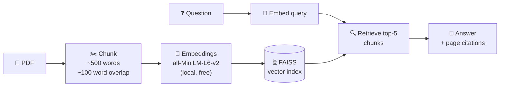

# 📄 DocuMind — Chat with Your PDFs

> **Ask questions. Get answers from the document — with page numbers.**

DocuMind is an offline-first **RAG (Retrieval-Augmented Generation)** research assistant. Upload any PDF — a research paper, a textbook chapter, a report — and ask questions about it in plain English. Every answer is grounded in the document itself and cited by page number, so you can always check where it came from.

No API keys required. No document ever leaves your machine.

## Why this matters

Reading a 40-page paper to find one answer is slow. Keyword search (Ctrl+F) only finds exact words, not meaning — ask "what were the side effects?" and it will not match "adverse events were observed in 12% of patients". DocuMind understands the *meaning* of your question, retrieves the most relevant passages, and answers from them — with citations, so nothing is taken on trust.

## How it works



1. **Ingest** — text is extracted page by page (`pypdf`) and split into overlapping ~500-word chunks. Chunks never cross a page boundary, so every chunk has exactly one page number.
2. **Embed** — each chunk is encoded with `all-MiniLM-L6-v2`, a small, fast sentence-embedding model that runs locally on CPU.
3. **Index** — embeddings are stored in a FAISS inner-product index (cosine similarity on normalised vectors).
4. **Retrieve** — a question is embedded the same way and the top-5 most similar chunks are fetched.
5. **Answer** — in one of two modes (below), with page citations on every claim.

## Answer modes

| Mode | When | How it answers |
| --- | --- | --- |
| **Extractive** (default) | No API key set | Returns the most relevant passages verbatim, each with its page number. Nothing is generated, so nothing can be hallucinated. |
| **Generative** | `OPENAI_API_KEY` is set | `gpt-4o-mini` writes a short answer **strictly from the retrieved passages**, with page citations. If the passages don't contain the answer, it says so instead of guessing. |

If the key is absent, DocuMind falls back to extractive mode automatically and tells you.

Both modes refuse to answer from outside knowledge: when the document doesn't cover a question, they say so.

## Features

- 📄 **Any PDF** — research papers, reports, textbooks, manuals
- 🔒 **Private by default** — embeddings and search run locally; the document never leaves your machine
- 📖 **Page citations** — every answer is traceable to its source passage
- 💬 **Chat UI** — Streamlit app with upload, progress, and a chat history
- ⌨️ **CLI** — ask from the terminal, with a cached FAISS index (re-indexes only when the PDF changes)
- 🧩 **Clean architecture** — `ingest` / `embeddings` / `vectorstore` / `qa` are separate modules, easy to swap (e.g. a different embedding model or a different LLM)

## Quick start

```bash
git clone https://github.com/zainify9898/documind.git
cd documind
python -m venv venv
source venv/bin/activate        # Windows: venv\Scripts\activate
pip install -r requirements.txt
```

> **Note:** `sentence-transformers` pulls in PyTorch (~200 MB CPU wheel). On a slow connection, install CPU-only torch first:
> `pip install torch --index-url https://download.pytorch.org/whl/cpu`

### Web UI

```bash
streamlit run app.py
```

Upload a PDF in the sidebar, wait for indexing, then ask questions in the chat box. Try `data/sample.pdf` first — a short document about AI in healthcare, included in the repo.

### Command line

```bash
python cli.py --pdf data/sample.pdf --question "What does the document say about AI in healthcare?"
```

For generated answers, set your key first:

```bash
export OPENAI_API_KEY="sk-..."
python cli.py --pdf report.pdf --question "Summarise the methodology."
```

## Example — measured on `data/sample.pdf`

The sample document is a 2-page summary of AI in healthcare (diagnosis, drug discovery, hospital administration, risks). These are the **real** answers DocuMind produced in extractive mode (no API key), verified by running `cli.py`:

**Q1 — "What does the document say about AI in healthcare?"**
Retrieved both chunks — p. 1 (similarity 0.57) and p. 2 (0.56) — covering diagnosis, drug discovery, hospital administration and risks.

**Q2 — "What accuracy did the AI system achieve in detecting diabetic retinopathy?"**
Top hit p. 1 (similarity 0.71), containing the exact passage: *"an AI system for detecting diabetic retinopathy from retinal photographs achieved 97.5 percent sensitivity and 93.4 percent specificity, matching the performance of specialist ophthalmologists."* [p. 1]

**Q3 — "What are the risks of using AI in healthcare?"**
Top hit p. 2 (similarity 0.63), the "Risks and Limitations" section: dataset bias, privacy regulations (GDPR, HIPAA), difficult-to-explain models, and slow regulatory approval. [p. 2]

Note the ranking works: the factoid question (Q2) ranks the diagnosis page first, the risks question (Q3) ranks the risks page first. In extractive mode the full retrieved passages are returned verbatim — precise, but long. Generative mode (with `OPENAI_API_KEY`) condenses them into a short cited answer.

## Project structure

```
documind/
├── app.py                  # Streamlit web UI
├── cli.py                  # Command-line interface (with index cache)
├── requirements.txt
├── data/
│   └── sample.pdf          # Demo document: AI in healthcare (2 pages)
├── scripts/
│   └── make_sample_pdf.py  # Regenerates data/sample.pdf
└── src/
    ├── ingest.py           # PDF text extraction + overlapping chunking
    ├── embeddings.py       # Local sentence-transformers embeddings
    ├── vectorstore.py      # FAISS index: build, save/load, top-k search
    └── qa.py               # RAG pipeline: extractive + generative modes
```

## Limitations

- **Extractive mode quotes, it doesn't summarise.** For a polished, synthesised answer, set `OPENAI_API_KEY` for generative mode.
- **Text PDFs only.** Scanned/image PDFs have no extractable text — OCR (e.g. `pytesseract`) is a planned addition.
- **English embeddings.** `all-MiniLM-L6-v2` is trained mainly on English; retrieval quality drops for other languages.
- **Small demo document.** The sample PDF has only 2 pages; retrieval shines on longer documents where finding the right passage is actually hard.
- **No multi-document support yet** — one PDF per session (see below).

## Future improvements

- [ ] OCR support for scanned PDFs
- [ ] Multi-document collections with per-document filters
- [ ] Chat history / follow-up questions (multi-turn RAG)
- [ ] Hybrid search (BM25 + vector) and re-ranking
- [ ] Support for local open-weight LLMs (e.g. via Ollama) so generative mode stays offline
- [ ] Export answers with citations to Markdown

## License

MIT — see [LICENSE](LICENSE).

Built by [Muhammad Zain Ul Islam](https://github.com/zainify9898) — BS Artificial Intelligence, Riphah International University.
